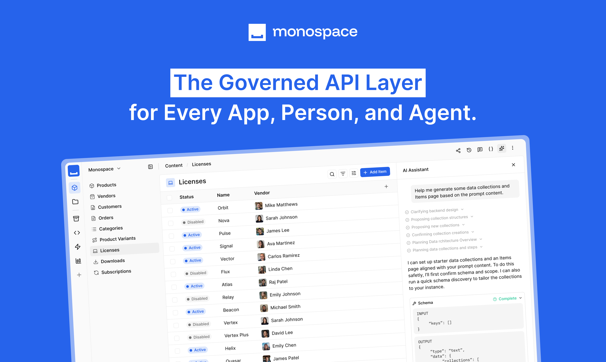
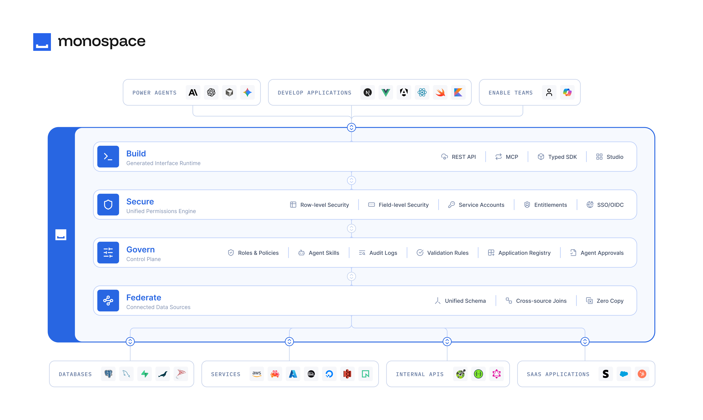

<p align="center">
  <picture style="display:block;">
    <source width="400" media="(prefers-color-scheme: light)" srcset="https://github.com/user-attachments/assets/27299ab8-c2a3-45d8-bf65-e830adefb454">
    <source width="400" media="(prefers-color-scheme: dark)" srcset="https://github.com/user-attachments/assets/fd1b456b-ca81-4ce1-a9a3-3285e16d7088">
    
  </picture>
</p>
<p align="center">
  <a href="https://monospace.io">Website</a> • <a href="https://docs.monospace.io">Documentation</a> • <a href="https://monospace.productlane.com/roadmap">Roadmap</a>
</p>

Monospace connects the systems your organization already runs and serves them through one governed API layer. Register a data source and Monospace exposes it four ways — a REST API, a typed TypeScript SDK, an MCP server, and the Studio. All four read and write live data under one permissions model.



## Overview

Monospace sits between your data sources and the agents, applications, and teams that use them. Data stays in the source systems, and every caller goes through the same permissions.



## Repository Contents

This repository holds the public resources for building with Monospace. It does not contain the Monospace source code.

| Path | Contents |
|---|---|
| [`docker-compose.yml`](docker-compose.yml) | Reference compose file for running Monospace locally |
| [`starters/`](starters) | Templates, starters, and reference projects |
| [`extensions/`](extensions) | Custom extensions, including data connectors |
| [`tooling/`](tooling) | Maintainer tools for the starters. Not part of any starter |

### Related Repositories

| Repository | Contents |
|---|---|
| [`directus/monospace-agent-skills`](https://github.com/directus/monospace-agent-skills) | Official [Agent Skills](https://agentskills.io) package — teaches your agent the REST API, the typed SDK, codegen, and the MCP tools |

Install it into Claude Code, or into any agent that supports the open standard:

```bash
# Claude Code
claude plugin marketplace add directus/monospace-agent-skills
claude plugin install monospace@monospace-agent-skills

# Other agents
npx skills add directus/monospace-agent-skills
```

## Quickstart

Start Monospace with a single command. The only prerequisite is [Docker Compose](https://docs.docker.com/compose/install/).

```bash
curl -fL https://docs.monospace.io/quick-start | docker compose -f - up
```

Alternatively, clone this repository and start the services from the included compose file:

```bash
git clone https://github.com/directus/monospace-starter.git
cd monospace-starter
docker compose up -d
```

Both start the same stack:

- **Monospace** — the application
- **PostgreSQL** — system database
- **RabbitMQ** — event bus for email delivery and webhooks
- **Redis** — query result cache

Open the Studio at <http://localhost:8100> once the containers are healthy. The first run takes 1–2 minutes.

Without a license, the instance runs on the Starter plan. To apply a license, set `MONOSPACE_LICENSE__KEY` in `docker-compose.yml` to your Monospace license key and run `docker compose up -d`. The instance validates the key with the Monospace licensing service on every startup and does not start if validation fails. See [Licensing](https://docs.monospace.io/en/reference/licensing).

See the [Quickstart guide](https://docs.monospace.io/en/getting-started/installation) to create your first workspace, connect a data source, and add collections.

## Starters

Starters are complete projects built on Monospace. Each one includes its data model and a working application, so you can run it locally and adapt it to your own data.

The root [starter workflow](.github/workflows/starters.yml) installs and runs `pnpm verify`, plus any `test:browser` scripts, for each starter on pull requests and pushes to `main` that change starter files. Maintainer tools and notes for a starter live in `tooling/<starter>`, for example [`tooling/monoerp`](tooling/monoerp).

| Starter | Contents |
|---|---|
| [`monoerp`](starters/monoerp) | A modular CRM app built with TanStack Start. Monospace joins PostgreSQL, an optional read-only MySQL demo, and Stripe through one API. Includes piece manifests, setup scripts, tests, and an AWS deploy |

Download one starter on its own, without the rest of this repository:

```bash
npx giget@latest gh:directus/monospace-starter/starters/monoerp monoerp
```

Each starter runs its own Monospace. Stop the stack from this repository's `docker-compose.yml` before starting one, since both use port 8100. Starters carry their own license; monoERP is MIT.

## Extensions

Extensions add capabilities to a Monospace instance. Data connector extensions connect APIs and other systems as data sources.

> [!NOTE]
> Data connector extensions are in preview. Their configuration format and APIs may change between releases.

Scaffold a data connector with the Monospace CLI:

```bash
npx @monospace/cli extension create ./acme-store --id acme/store --name "Acme Store"
```

To run an extension against the local stack, create an `extensions` directory in this repository. In `docker-compose.yml`, swap the `extensions_data` volume for the `./extensions` bind mount and restart the services. Then build into it from your extension project:

```bash
npm run build -- --install-to ../monospace-starter/extensions
```

See the [CLI reference](https://docs.monospace.io/en/reference/cli#scaffold-a-data-connector) for the extension config and build options.

## Support

This repository does not accept issues. Report problems and requests through Productlane instead.

- [Report an issue](https://monospace.productlane.com/support) — a bug or problem with Monospace or the documentation
- [Request a feature](https://monospace.productlane.com/request) — submit an idea or vote on existing ones
- [Roadmap](https://monospace.productlane.com/roadmap) — see what's planned and in progress

## Next Steps

- [Introduction](https://docs.monospace.io/en/getting-started/introduction) — what Monospace is and how it fits together
- [Organization Hierarchy](https://docs.monospace.io/en/concepts/organization) — organizations, workspaces, and data sources
- [SDK](https://docs.monospace.io/en/guides/sdk) — generate a typed client for your workspace
- [MCP](https://docs.monospace.io/en/guides/mcp) — connect an agent to a workspace
- [Environment Variables](https://docs.monospace.io/en/reference/environment-variables) — configure an instance

## License

© Monospace, Inc. All rights reserved. Use is subject to the [Monospace Terms](https://monospace.io/terms).
