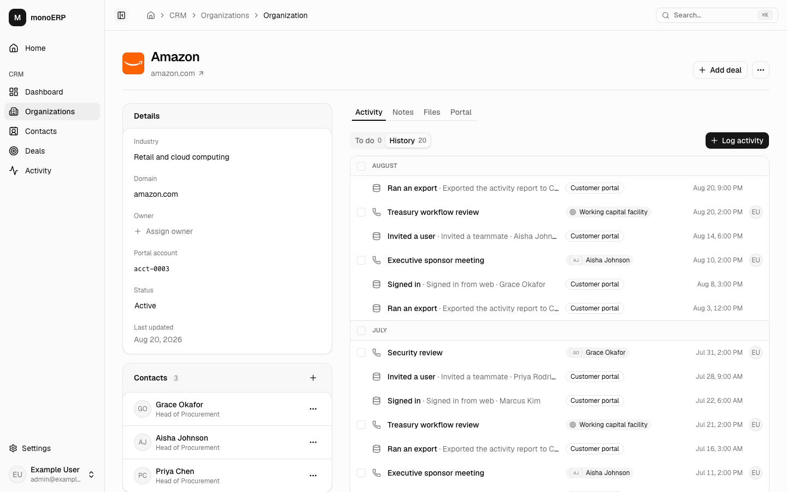

<p align="center">
  <picture>
    <source media="(prefers-color-scheme: dark)" srcset=".github/assets/monospace-logo-on-dark.svg">
    
  </picture>
</p>

<h1 align="center">monoERP</h1>

<p align="center">
  An open business app built on Monospace. One app over data that lives in more than one database.
</p>

<p align="center">
  <a href="#quickstart">Quickstart</a> •
  <a href="docs/getting-started.md">Getting started guide</a> •
  <a href="#built-for-agents">Built for agents</a> •
  <a href="infra/aws/README.md">Deploy to AWS</a> •
  <a href="https://monospace.io">Monospace</a> •
  <a href="https://docs.monospace.io">Monospace docs</a>
</p>

<p align="center">
  
</p>

## What this is

Most business data doesn't live in one place. The sales team's records are in one database, and the product's customer data is in another, owned by another team. monoERP shows what building on top of that looks like, without copying data around.

- **CRM module:** organizations, contacts, deals, and activity, stored in PostgreSQL.
- **Portal (optional demo):** a demo of Monospace's MySQL connector, installed by default to show read-only joins across databases. Remove it with `pnpm app:remove portal`, then follow the [shared removal steps](connectors/README.md#remove-a-module-or-connector). CRM still works; Portal UI and the dependent Billing tab disappear. See [Portal setup](connectors/portal/README.md).
- **Stripe (optional demo):** billing, read through a custom Monospace data connector (`connectors/stripe`). Locally it runs against a Stripe emulator, so no Stripe account is needed.
- **Monospace** joins all three into one typed API with one set of permissions. An organization's page shows its CRM record next to its plan, seats, support tickets, and payments, and it doesn't feel like three systems.

More modules can plug in next to the CRM. The app is TanStack Start, React, Tailwind, and shadcn/ui.

> [!NOTE]
> monoERP is an example and a starting point, not a supported product.

## Quickstart

You need Node 24, pnpm, and Docker.

```bash
npx giget@latest gh:directus/monospace-starter/starters/monoerp monoerp
cd monoerp
cp .env.example .env    # local defaults; change nothing to start
pnpm install
docker compose up -d --wait --wait-timeout 180 # Monospace, both databases, a local Stripe, RabbitMQ, Mailpit
pnpm setup:all          # creates and configures the Monospace workspace
pnpm dev
```

Open http://localhost:3000 and sign in with `admin@example.com` / `monospace`. It comes with demo data: well-known companies, with fictional contacts, deals, and activity.

New here? [The getting started guide](docs/getting-started.md) shows you around and walks through the first changes you'll want to make.

| Also running                            | Where (default port)  |
| --------------------------------------- | --------------------- |
| Monospace Studio (Monospace's admin UI) | http://localhost:8100 |
| Mailpit (catches invite and reset mail) | http://localhost:8025 |

<details>
<summary>First-run notes, other ports, and the license key</summary>

- The first `docker compose up` loads the demo data, which takes a minute or two. The `keygen` container generates Monospace's keys and exits; that's expected. `pnpm setup:all` waits for Monospace.
- The first time you open Studio, it asks you to accept its terms and then to create a workspace, even though `crm` already exists. Open Studio in a new tab to skip that.
- monoERP runs its own Monospace. If another app uses port 8100, choose different ports as described below.
- **Ports** are in `.env`, and everything follows them, including `pnpm dev`. To run a second copy next to the first, change all the ports and set its own Docker project name with `COMPOSE_PROJECT_NAME=monoerp-2` in its `.env`, or the two share containers and data. Put it in `.env` rather than exporting it, so every terminal (and `pnpm setup:all`) uses it.
- **License key:** optional. Without one, Monospace runs on its free tier, and the CRM quickstart works without skipped features. The free tier allows 1 workspace and 3 users, with no custom roles, service accounts, or SSO, and it sends usage telemetry. To use a key, set `MONOSPACE_LICENSE__KEY` in `.env`. Without one, leave that line commented out: Monospace refuses to start with an empty key.

</details>

## Built for agents

This repo is set up for working with AI coding agents like Claude Code, Codex, and Cursor, as well as by hand.

- **[`AGENTS.md`](AGENTS.md)** is a short map: how to get a working stack, the rules, and which doc in [`docs/`](docs) to read for the area you're changing. The docs describe how things actually work, with file paths to jump to.
- **One command checks everything:** `pnpm verify`. An agent knows when it's done.
- **Lint rules catch sloppy code:** casts without a reason, `unknown` types, and module mocks all fail the build (`tools/oxlint`).
- **Access rules live in one place.** Monospace decides permissions on every request, and the app's API client is generated from the schema, so there's no hand-written data layer for an agent to get wrong.

## Everyday commands

| Command                                       | What it does                                                          |
| --------------------------------------------- | --------------------------------------------------------------------- |
| `pnpm dev`                                    | The app with hot reload                                               |
| `pnpm verify`                                 | Check, typecheck, unit tests, and production build                    |
| `pnpm check`                                  | Format and lint (what the pre-commit hook runs)                       |
| `pnpm typecheck`                              | TypeScript                                                            |
| `pnpm test`                                   | Unit tests                                                            |
| `pnpm --filter @monoerp/web test:browser`     | Browser tests in Chromium, no server needed                           |
| `pnpm format`                                 | Fix formatting                                                        |
| `pnpm setup:all`                              | Configure the Monospace workspace. Safe to rerun after pulling        |
| `pnpm build:extensions`                       | Rebuild selected connectors; Monospace picks them up on its own       |
| `pnpm generate`                               | Rebuild the typed Monospace client after a schema change              |
| `pnpm db:migrate`                             | Apply new CRM database migrations                                     |
| `pnpm schema:export`                          | Save Studio changes (labels, field order, and so on) back to the repo |
| `docker compose --profile full up -d --build` | Run the app in a container too, behind Caddy                          |

## How it fits together

The browser only talks to the app's own address. The app's server proxies `/api/*` to Monospace, so the Monospace session cookie stays same-origin. Screens call Monospace straight from the browser with the generated SDK and TanStack Query. There's no app database and no API layer of our own.

A module is four folders: manifest, UI, infrastructure, and routes. See [the module layout](docs/modules.md#add-a-module).

| Area       | Path                                                                | Purpose                                              |
| ---------- | ------------------------------------------------------------------- | ---------------------------------------------------- |
| Core       | `starter.json`                                                      | Shared ownership manifest                            |
| Core       | `apps/web/src/shell`, `apps/web/src/lib`, `apps/web/src/components` | Shell, authentication, and shared UI                 |
| Core       | `infra/monospace`, `infra/postgres`                                 | Shared workspace setup and PostgreSQL service        |
| Core       | `infra/aws`, `tools/oxlint`                                         | Optional deployment and code checks                  |
| Modules    | `modules/<id>`                                                      | Module manifest                                      |
| Modules    | `apps/web/src/modules/<id>`                                         | UI entry, copy, reads, and writes                    |
| Modules    | `infra/modules/<id>`                                                | SQL, demo data, schema settings, and setup           |
| Modules    | `apps/web/src/routes/_app/<id>`                                     | Pages                                                |
| Connectors | `connectors/<id>`                                                   | Removable external sources and their local stand-ins |
| Connectors | `connectors/portal`                                                 | Read-only MySQL demo and Portal UI                   |
| Connectors | `connectors/stripe`                                                 | Stripe API extension, local emulator, and Billing UI |

To change the CRM schema, add a migration in `infra/modules/crm/postgres/migrations`, make the same change in `infra/modules/crm/postgres/init/001_schema.sql`, then run `pnpm db:migrate`, `pnpm setup:introspect`, and `pnpm generate`. [`docs/data-model.md`](docs/data-model.md) has the details.

## Docs

| Doc                                             | Covers                                                                     |
| ----------------------------------------------- | -------------------------------------------------------------------------- |
| [`getting-started.md`](docs/getting-started.md) | Run it, look around, and make it yours: fields, databases, Stripe, modules |
| [`architecture.md`](docs/architecture.md)       | How a request flows, sign-in, permissions, the three sources               |
| [`frontend.md`](docs/frontend.md)               | How screens are built: lists, forms, inline editing, copy, styling         |
| [`modules.md`](docs/modules.md)                 | The module contract and how to add one                                     |
| [`data-model.md`](docs/data-model.md)           | The tables, how the databases connect, schema changes, demo data           |
| [`monospace.md`](docs/monospace.md)             | Setup scripts, connectors, the generated client, Monospace issues          |
| [`testing.md`](docs/testing.md)                 | Tests, lint rules, CI                                                      |
| [`infra/aws/README.md`](infra/aws/README.md)    | Deploying to AWS                                                           |

## Deploy to AWS

One command builds a stage: network, PostgreSQL, MySQL, Valkey, RabbitMQ, Monospace, the app, CloudFront, a firewall, alarms, and autoscaling. AWS deployment is optional. The included GitHub Actions workflow checks and builds the app without an AWS account.

Needs a Monospace license key. AWS does not install the Stripe extension yet, so Billing is unavailable there.

```bash
pnpm aws:deploy --stage staging
```

[The AWS guide](infra/aws/README.md) covers setup, alarms, backups, and teardown.

## License

MIT, see [`LICENSE`](LICENSE). Code copied from other projects keeps its own license next to it: the ReUI components (`apps/web/src/components/reui`) and the lint rules in `tools/oxlint/anti-slop`, both MIT.
