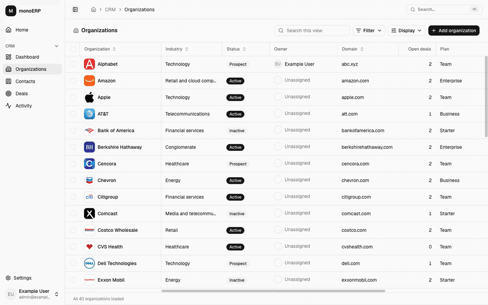

<p align="center">
  <picture>
    <source media="(prefers-color-scheme: dark)" srcset=".github/assets/monospace-logo-on-dark.svg">
    
  </picture>
</p>

<h1 align="center">monoERP</h1>

<p align="center">
  An open business app built on Monospace. One app over data that lives in more than one database.
</p>

<p align="center">
  <a href="https://github.com/directus/monospace-starter/releases?q=monoerp"></a>
  <a href="LICENSE"></a>
  
  
  <a href="https://monospace.io"></a>
</p>

<p align="center">
  <a href="#quickstart">Quickstart</a> •
  <a href="docs/getting-started.md">Getting started guide</a> •
  <a href="#built-for-agents">Built for agents</a> •
  <a href="docs/deploy.md">Deploy</a> •
  <a href="https://github.com/directus/monospace-starter/releases?q=monoerp">Releases</a> •
  <a href="https://docs.monospace.io">Monospace docs</a>
</p>

<p align="center">
  <picture>
    <source media="(prefers-color-scheme: dark)" srcset=".github/assets/tour-dark.gif">
    
  </picture>
</p>

## What's inside

Business data rarely lives in one place. Sales records sit in one database, the product's customer data in another, billing in Stripe. monoERP builds one app over all three without copying data around: an organization's page shows its CRM record next to its plan, seats, tickets, and payments.

| Part                        | Kind          | What it adds                                            | Stored in                 |
| --------------------------- | ------------- | ------------------------------------------------------- | ------------------------- |
| [CRM](modules/crm)          | Module        | Organizations, contacts, and deals.                     | PostgreSQL                |
| [Portal](connectors/portal) | Connector     | Example customer database (a MySQL demo you can remove) | MySQL, read-only          |
| [Stripe](connectors/stripe) | Connector     | Billing data from Stripe                                | Stripe (emulated locally) |
| [AWS deploy](deploy/aws)    | Deploy target | Fargate, RDS and GitHub OIDC with Alchemy               |                           |

Monospace joins the three sources into one typed API with one set of permissions. Every part is optional: remove Portal and CRM still works, and the Billing tab that depends on it turns off. More modules can plug in next to the CRM. The app is TanStack Start, React, Tailwind, and shadcn/ui.

> [!NOTE]
> monoERP is an example and a starting point, not a supported product.

## Quickstart

You need Node 24, pnpm, and Docker.

Once the Monospace CLI ships `create`, it asks which modules, connectors, and deploy target to keep, then prints the commands below:

```bash
npx @monospace/cli create my-erp
```

Until then, download the starter as it is:

```bash
npx giget@latest gh:directus/monospace-starter/starters/monoerp monoerp
cd monoerp
```

Then run it. `pnpm install` goes before Docker; it writes `.env` (free ports, its own Docker project name) and the Compose include file.

```bash
pnpm install
docker compose up -d --wait --wait-timeout 180 # Monospace, both databases, a local Stripe, RabbitMQ, Mailpit
pnpm setup:all          # creates and configures the Monospace workspace
pnpm dev
```

**If setup gets stuck:**

- **Port taken.** Another app on the Monospace port (8100 by default) blocks this copy's Monospace. `pnpm setup:all` says so and stops. Stop that app, or change the port in `.env`. For the other ports, `docker compose up` or `pnpm dev` reports it; change it in `.env`.
- **Monospace keeps restarting.** `pnpm setup:all` prints its last log lines. A license refusal means this Docker project has old data, often from another copy in a folder with the same name and no `COMPOSE_PROJECT_NAME` in `.env`. Set a new `COMPOSE_PROJECT_NAME` in `.env` to start clean.
- **Access denied for user 'root' at "Portal reader login".** `CUSTOMER_MYSQL_ROOT_PASSWORD` in `.env` changed after the Portal database was created. Set it back to the old value.

Open http://localhost:3000 (or the address `pnpm install` printed) and sign in with `admin@example.com` / `monospace`. It comes with demo data: well-known companies, with fictional contacts, deals, and activity.

New here? [The getting started guide](docs/getting-started.md) shows you around and walks through the first changes you'll want to make.

| Also running                            | Where (default port)  |
| --------------------------------------- | --------------------- |
| Monospace Studio (Monospace's admin UI) | http://localhost:8100 |
| Mailpit (catches invite and reset mail) | http://localhost:8025 |

<details>
<summary>First-run notes, other ports, and the license key</summary>

- The first `docker compose up` loads the demo data, which takes a minute or two. The `keygen` container generates Monospace's keys and exits; that's expected. `pnpm setup:all` waits for Monospace.
- The first time you open Studio, it asks you to accept its terms and then to create a workspace, even though `monoerp` already exists. Open Studio in a new tab to skip that.
- **Ports** are in `.env`, and everything follows them, including `pnpm dev`. The first `pnpm install` picks free ones and a unique `COMPOSE_PROJECT_NAME`, so a fresh download runs next to another copy as is. If you copy a folder that already has a `.env`, delete it in the copy before `pnpm install`, or both copies share one Docker stack.
- **License key:** optional locally. See [the free tier and license setup](docs/monospace.md#license-key-and-the-free-tier).

</details>

## Built for agents

This repo is set up for working with AI coding agents like Claude Code, Codex, and Cursor, as well as by hand.

- **[`AGENTS.md`](AGENTS.md)** is a short map: how to get a working stack, the rules, and which doc in [`docs/`](docs) to read for the area you're changing. The docs describe how things actually work, with file paths to jump to.
- **One command checks everything:** `pnpm verify`. An agent knows when it's done.
- **Lint rules catch sloppy code:** casts without a reason, `unknown` types, and module mocks fail lint ([core strict lint](tools/oxlint/README.md)).
- **Access rules live in one place.** Monospace decides permissions on every request, and the app's API client is generated from the schema, so there's no hand-written data layer for an agent to get wrong.

## Everyday commands

| Command                                       | What it does                                                          |
| --------------------------------------------- | --------------------------------------------------------------------- |
| `pnpm dev`                                    | The app with hot reload                                               |
| `pnpm verify`                                 | Check, typecheck, unit tests, and production build                    |
| `pnpm check`                                  | Format and lint (what the pre-commit hook runs)                       |
| `pnpm typecheck`                              | TypeScript                                                            |
| `pnpm test`                                   | Unit tests                                                            |
| `pnpm --filter @monoerp/web test:browser`     | Browser tests in Chromium, no server needed                           |
| `pnpm format`                                 | Fix formatting                                                        |
| `pnpm app:doctor`                             | List the installed parts and check their manifests                    |
| `pnpm setup:all`                              | Configure the Monospace workspace. Safe to rerun after pulling        |
| `pnpm build:extensions`                       | Rebuild selected connectors; Monospace picks them up on its own       |
| `pnpm generate`                               | Rebuild the typed Monospace client after a schema change              |
| `pnpm db:migrate`                             | Apply new app database migrations                                     |
| `pnpm schema:export`                          | Save Studio changes (labels, field order, and so on) back to the repo |
| `docker compose --profile full up -d --build` | Run the app in a container too, behind Caddy                          |

## Project layout

```text
apps/web/         The TanStack Start app: shell, sign-in, shared components, generated client
modules/crm/      The CRM: manifest, pages, reads, writes, SQL, demo data, setup
connectors/       Portal (MySQL demo) and Stripe (extension, emulator, Billing UI)
deploy/aws/       Optional AWS deploy
infra/            Shared Monospace setup, PostgreSQL, Caddy, installed connector builds
docs/             The guides
starter.json      Shared ownership manifest and the commands the CLI prints
```

The browser only talks to the app's own address. The app's server proxies `/api/*` to Monospace, so the Monospace session cookie stays same-origin. Screens call Monospace straight from the browser with the generated SDK and TanStack Query. There's no app database and no API layer of our own.

A part is one folder: `modules/<id>`, `connectors/<id>`, or `deploy/<id>`, with its manifest inside (`module.json`, `connector.json`, `deploy.json`). A module's pages live in `modules/<id>/routes/{app,settings,public}`, mounted at `/<id>`, `/settings/<id>`, and the site root. See [the module layout](docs/modules.md#add-a-module).

To change the CRM schema, add a migration in `modules/crm/infra/postgres/migrations`, make the same change in `modules/crm/infra/postgres/init/001_schema.sql`, then run `pnpm db:migrate`, `pnpm setup:introspect`, and `pnpm generate`. [`docs/data-model.md`](docs/data-model.md) has the details.

## Removing parts

Preview with `pnpm app:remove <id> --dry-run`, then run `pnpm app:remove <id>`. The ids are the folder names: `crm`, `portal`, `stripe`, `aws`. Removal deletes the part's folder and anything else its manifest owns, and refuses a part that another installed part requires.

- Removing **Portal** keeps CRM working. Stripe's Billing tab needs Portal, so it turns off, and the command says so. Remove Stripe too if you don't want it.
- Removing **Stripe** hides the Billing tab.
- Removing **CRM** leaves the shell, sign-in, and settings; connectors stay installed until removed separately.
- Removing **AWS** also drops its workflow, package script, and patch.

After a module or connector removal, follow the [shared removal steps](connectors/README.md#remove-a-module-connector-or-deploy-target) to retire its source and regenerate the app. The guides in `docs/` describe the full selection; drop what no longer applies.

## Deploy

See [deployment](docs/deploy.md) for hosting requirements and the optional deploy targets.

## Docs

| Doc                                             | Covers                                                                     |
| ----------------------------------------------- | -------------------------------------------------------------------------- |
| [`getting-started.md`](docs/getting-started.md) | Run it, look around, and make it yours: fields, databases, Stripe, modules |
| [`architecture.md`](docs/architecture.md)       | How a request flows, sign-in, permissions, the three sources               |
| [`frontend.md`](docs/frontend.md)               | How screens are built: lists, forms, inline editing, copy, styling         |
| [`modules.md`](docs/modules.md)                 | The module contract and how to add one                                     |
| [`data-model.md`](docs/data-model.md)           | The tables, how the databases connect, schema changes, demo data           |
| [`monospace.md`](docs/monospace.md)             | Setup scripts, connectors, the generated client, Monospace issues          |
| [`testing.md`](docs/testing.md)                 | Tests, lint rules, CI                                                      |
| [`deploy.md`](docs/deploy.md)                   | Hosting the app                                                            |

## License

MIT, see [`LICENSE`](LICENSE). Code copied from other projects keeps its own license next to it: the ReUI components (`apps/web/src/components/data-table` and `apps/web/src/components/filters`) and the lint rules in [strict lint rules](tools/oxlint/strict), both MIT.
